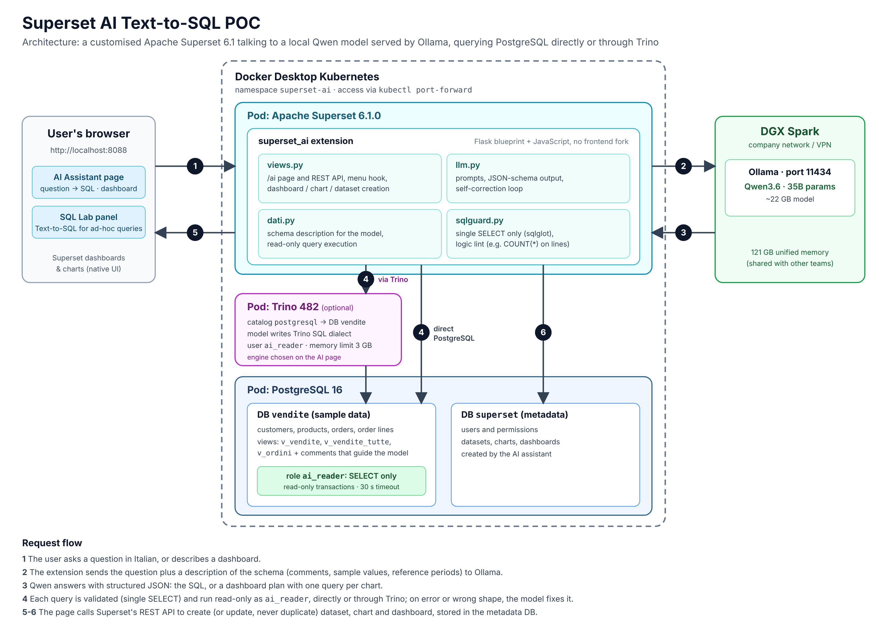

> Italian documentation (original). The main README is [README.md](README.md) (English).

# POC: Superset con Text-to-SQL e dashboard al volo (Ollama sulla DGX Spark)

Superset 6.1.0 su Kubernetes (Docker Desktop) con un'estensione che usa il modello **qwen3.6:35b** di Ollama sulla DGX Spark per:

- **AI Assistant** (menu **AI > AI Assistant**, oppure pulsante in basso a destra): domanda in italiano, poi query SQL, risultati e **dashboard creata al volo** con 18 tipi di grafico (KPI, linee, aree, barre, torta, imbuto, treemap, heatmap, pivot, bolle, box plot, istogramma, tabella...: vedi [Tipi di grafico](#tipi-di-grafico)).
- **Text-to-SQL dentro SQL Lab**: pulsante **Text-to-SQL** in basso a destra. Genera la query e la apre in una nuova scheda di SQL Lab, oppure la inserisce (selezionata) nell'editor corrente.
- **Due motori SQL**: PostgreSQL diretto oppure **Trino** davanti allo stesso Postgres. Con Trino il modello scrive SQL nel dialetto di Trino (vedi [Trino](#trino)). L'estensione funziona anche con altri database (Oracle, SQL Server, MySQL, Hive...): vedi [Adattare la POC a un altro database](#adattare-la-poc-a-un-altro-database).
- **Registro delle richieste** con il voto degli utenti, **prove automatiche** con report, **cache Redis** e, se serve, **query asincrone** in SQL Lab con un worker Celery.



I dati sono **inventati**: un negozio di elettronica con 400 clienti, 60 prodotti e circa 5.300 ordini (10.000 righe) da novembre 2025 a ottobre 2026.

```
 Browser ──port-forward 8088──► Superset (pod) ── SQL PostgreSQL, utente ai_reader ──────────► Postgres (pod)
   │                              │  estensione       └─ SQL Trino ──► Trino (pod) ──ai_reader──►  ├─ db "vendite"  (dati)
   │                              │  superset_ai                                                  └─ db "superset" (metadati)
   │                              ├── cache e code ──► Redis (pod) ◄── worker Celery (pod, facoltativo)
   │                              └── HTTP 11434 ──► Ollama sulla DGX Spark (10.100.208.51), qwen3.6:35b
   └─ REST API di Superset (crea dataset, grafici, dashboard con i permessi dell'utente collegato)
```

---

## Prerequisiti

1. Docker Desktop con **Kubernetes attivo** (contesto `docker-desktop`), con almeno 4 GB di RAM e 2 CPU assegnati (6 GB con Trino; circa 1 GB in più con il worker Celery).
2. PC in ufficio o in VPN: la Spark (`10.100.208.51`) deve essere raggiungibile.
3. **Avvisa il collega della Spark**: `qwen3.6:35b` occupa circa 22 GB di memoria quando viene caricato su una macchina condivisa.

## Avvio (PowerShell, dalla cartella del progetto)

```powershell
cd C:\Users\G.Strada\Documents\02_PROGETTI\AI\Accesso_spark\superset-ai-poc

# Se PowerShell blocca gli script:
Set-ExecutionPolicy -Scope Process Bypass

# 1. Verifica che i pod raggiungano Ollama sulla Spark
.\scripts\test-ollama.ps1

# 2. Build dell'immagine e deploy di Postgres + Superset (stampa la password di admin)
.\scripts\deploy.ps1

# 3. Port-forward, poi apri http://localhost:8088  (utente admin)
.\scripts\forward.ps1
```

Al primo avvio:

- `docker build` scarica `apache/superset:6.1.0` (circa 1-2 GB);
- Postgres crea i database e genera i dati (pochi secondi);
- Superset esegue le migrazioni e crea l'utente admin e la connessione **Vendite (POC)** (1-2 minuti).

Altri script:

| Script | Cosa fa |
|---|---|
| `.\scripts\password.ps1` | mostra la password di admin |
| `.\scripts\deploy.ps1 -SkipBuild` | riapplica la configurazione senza ricostruire l'immagine |
| `.\scripts\deploy.ps1 -Model qwen3-coder:30b -SkipBuild` | cambia modello |
| `.\scripts\deploy.ps1 -OllamaUrl http://host.docker.internal:11435 -SkipBuild` | cambia l'indirizzo di Ollama (vedi sotto) |
| `.\scripts\deploy.ps1 -Asincrono` | aggiunge il worker Celery: query asincrone in SQL Lab (vedi [Cache Redis e worker Celery](#cache-redis-e-worker-celery)) |
| `.\scripts\prove.ps1` | prove automatiche con report (vedi [Prove automatiche](#prove-automatiche)) |
| `.\scripts\aggiorna-db.ps1` | riapplica le viste di analisi (`05-viste-vendite.sql`) al database esistente e riavvia Superset |
| `.\scripts\destroy.ps1` | ferma i pod (dati e password restano) |
| `.\scripts\destroy.ps1 -Purge` | cancella tutto, dati compresi |

---

Per verificare la POC con domande e valori attesi: **[PROVE.md](PROVE.md)**, oppure in automatico con le [prove automatiche](#prove-automatiche).

## Tipi di grafico

Le dashboard al volo usano 18 tipi di grafico di Superset, raggruppati per **forma dei dati**: il modello sa che forma deve avere il risultato della query, l'estensione la controlla prima di creare il grafico e, se non va, la spiega al modello e si fa correggere la query (`superset_ai/grafici.py`).

| Forma dei dati | Tipi (nome nel piano) | Grafico di Superset |
|---|---|---|
| **Un valore** (1 riga, 1 numero) | KPI (`big_number`), indicatore a lancetta (`gauge`) | Big Number, Gauge |
| **Andamento nel tempo** (data, valore, serie facoltativa) | linee (`line`), aree (`area`, impilate con la serie), KPI con andamento (`big_number_trend`) | Line, Area, Big Number with Trendline |
| **Categorie** (categoria, valore, serie facoltativa) | barre (`bar`, affiancate con la serie), barre orizzontali (`bar_horizontal`), barre impilate (`bar_stacked`), torta (`pie`), ciambella (`donut`), imbuto (`funnel`), `treemap` | Bar, Pie, Funnel, Treemap |
| **Due categorie** (categoria, serie, valore) | mappa di calore (`heatmap`), tabella pivot (`pivot`) | Heatmap, Pivot Table |
| **Punti** (etichetta, due valori, dimensione facoltativa) | bolle / dispersione (`bubble`) | Bubble Chart |
| **Osservazioni** (una riga per osservazione, non aggregata) | `box_plot` (mediana, quartili, media, minimo e massimo), istogramma (`histogram`) | Box Plot, Histogram |
| **Dettaglio** | tabella (`table`) | Table |

Esempio: *"Box plot dell'importo degli ordini per canale, con media e mediana"* produce un box plot per canale calcolato sui singoli ordini (i baffi arrivano all'ordine più alto e a quello più basso) e, se richiesti, KPI con la media. Se la query restituisce solo categoria e valore, senza un identificativo per riga, l'estensione numera le righe da sola (colonna `ai_osservazione`), in ogni dialetto SQL. Ogni grafico creato si può poi modificare in Superset come un grafico normale.

## Prove automatiche

`.\scripts\prove.ps1` pone al modello vero le domande di `config\vendite\prove.yaml` (gli stessi casi di PROVE.md, con i valori attesi), esegue la SQL generata e confronta i risultati. Le prove girano **dentro il pod di Superset**, con lo stesso modello, lo stesso database e la stessa configurazione della pagina AI.

```powershell
.\scripts\prove.ps1                         # tutte, su tutti i motori (10-15 minuti)
.\scripts\prove.ps1 -Solo 1.2,4.*           # solo alcune (* = jolly)
.\scripts\prove.ps1 -Motore trino           # un solo motore
```

- Durante l'esecuzione compare una riga per prova (✅ superata, ❌ risultato sbagliato, ⚠️ query non eseguibile) con il motivo, per esempio *"atteso 4899, trovati 5189"*.
- Alla fine si trova il report in `prove-risultati\<data-ora>.md`, con un riepilogo per motore (percentuale di prove superate, tempo medio), l'elenco delle prove e la SQL di quelle non superate. Lo stesso report è salvato anche in JSON.
- Ogni esecuzione completa viene confrontata con la precedente (`prove-risultati\ultimo.json`): il report dice quali prove sono **peggiorate** e quali **migliorate**. È il modo per capire se una modifica al prompt, alle viste o al modello ha migliorato davvero le risposte.
- Le dashboard (sezione 7) vengono progettate e verificate come nella pagina AI, ma non create in Superset: si controlla che nei dati dei grafici compaiano i valori attesi.
- Il formato del file è descritto in testa a `config\vendite\prove.yaml`. Per un altro database basta scrivere un `prove.yaml` nella sua cartella di configurazione.

## Come si usa

### AI Assistant (`http://localhost:8088/ai/`)

- **Domanda → SQL**: scrivi per esempio *"Top 10 prodotti per margine"* e premi **Genera ed esegui** (o Ctrl+Invio). Vedi la spiegazione, la SQL (modificabile, con **Riesegui SQL**) e i risultati. **Apri in SQL Lab** porta la query in una nuova scheda.
- **Dashboard al volo**: descrivi la dashboard, per esempio *"Panoramica vendite: KPI, andamento mensile, categorie e canali"*. Il modello progetta da 3 a 6 grafici. L'estensione esegue ogni query, corregge colonne e tipo di grafico in base ai dati reali, e chiede una correzione al modello se una query fallisce. Poi crea dataset, grafici e dashboard e la apre in una nuova scheda. I grafici con query ancora non valide vengono scartati e indicati nel registro. Si può chiedere un tipo di grafico preciso (*"box plot"*, *"heatmap"*, *"tabella pivot"*...): vedi [Tipi di grafico](#tipi-di-grafico).
- **Motore** (in alto): *PostgreSQL (diretto)* o *Trino*. Vale per domande, dashboard e pannello di SQL Lab, e resta memorizzato nel browser.
- **Verifica connessione** (in alto) controlla Ollama, la presenza del modello, il database e, se attivo, Trino (tabelle e viste visibili).
- **Voto**: sotto ogni risposta e ogni dashboard, *"La risposta è corretta?"* con 👍 / 👎 (con il 👎 si può scrivere cosa non va).
- **Registro delle richieste** (in fondo alla pagina): domande, dashboard e SQL rieseguite, con utente, motore, esito, righe, tempo e voto; **Scarica CSV** per analizzarlo in Excel. Un amministratore vede le richieste di tutti, gli altri utenti solo le proprie. Il registro sta nella tabella `ai_registro` del database dei metadati di Superset, creata al primo uso.

### SQL Lab

Pulsante **Text-to-SQL** in basso a destra (visibile solo in SQL Lab):

- **Apri in nuova scheda**: crea una scheda "AI: ..." con la query e il database *Vendite (POC)* già selezionato.
- **Inserisci nell'editor**: accoda la query a quella della scheda corrente separandola con `;` e la seleziona, così **Run** esegue solo quella. Se non c'è nessuna scheda aperta, ne apre una nuova.

Le query vengono generate per il database del motore scelto nel pannello: *Vendite (POC)* (PostgreSQL) o *Vendite via Trino*.

---

## Sicurezza della POC

- Tutte le query sui dati usano l'utente Postgres **`ai_reader`**, che ha **solo permessi SELECT**, transazioni in sola lettura e un timeout di 30 secondi. È la protezione principale: anche una query di modifica verrebbe rifiutata dal database (verificato).
- In più l'estensione accetta solo **una singola SELECT** (controllo con sqlglot) prima di eseguirla.
- Anche SQL Lab usa `ai_reader`, quindi nella POC non si possono modificare i dati da Superset.
- Pagina e API richiedono il login di Superset. La protezione CSRF e la Content Security Policy di Superset restano attive: gli script dell'estensione usano il nonce.
- **Cosa esce dal PC**: schema del database (tabelle, colonne, commenti, valori tipici delle colonne a bassa cardinalità) e le tue domande vanno alla Spark. I risultati delle query no. Per dati aziendali reali chiedi prima l'autorizzazione.
- Le password sono generate casualmente da `deploy.ps1` e stanno nel Secret `superset-ai-secrets`.
- Il **registro delle richieste** conserva domande, SQL ed esiti nel database dei metadati di Superset, non i risultati delle query. Ogni utente vede solo le proprie richieste; un amministratore le vede tutte.
- **Trino** non ha login (scelta della POC) ma è raggiungibile solo dentro il cluster. Legge Postgres con lo stesso utente `ai_reader`, quindi la sola lettura vale anche passando da Trino. Le query dell'AI su Trino hanno un tempo massimo di 60 secondi.

---

## Se i pod non raggiungono la Spark

`test-ollama.ps1` prova la connessione prima dal PC, poi da un pod temporaneo.

- **Fallisce anche dal PC**: non sei in VPN/ufficio, oppure un firewall blocca la porta 11434.
- **Funziona dal PC ma non dal pod**: un caso possibile è che `10.100.208.51` cada nell'intervallo di indirizzi interni dei Service di Kubernetes di Docker Desktop (di solito `10.96.0.0/12`, cioè da 10.96.0.0 a 10.111.255.255) e che il cluster lo intercetti. In quel caso fai passare il traffico dal tuo PC.

  **Soluzione A, tunnel SSH** (una finestra PowerShell da tenere aperta):
  ```powershell
  ssh -N -L 0.0.0.0:11435:localhost:11434 dgx@10.100.208.51
  .\scripts\deploy.ps1 -OllamaUrl http://host.docker.internal:11435 -SkipBuild
  ```

  **Soluzione B, inoltro di Windows** (PowerShell come amministratore, resta attivo anche dopo il riavvio):
  ```powershell
  netsh interface portproxy add v4tov4 listenaddress=0.0.0.0 listenport=11435 connectaddress=10.100.208.51 connectport=11434
  .\scripts\deploy.ps1 -OllamaUrl http://host.docker.internal:11435 -SkipBuild
  # per toglierlo: netsh interface portproxy delete v4tov4 listenaddress=0.0.0.0 listenport=11435
  ```

  Poi verifica con `.\scripts\test-ollama.ps1 -OllamaUrl http://host.docker.internal:11435`.

---

## Risoluzione problemi

```powershell
kubectl get pods -n superset-ai
kubectl logs -n superset-ai deploy/superset -c init     # inizializzazione di Superset
kubectl logs -n superset-ai deploy/superset             # server Superset (errori dell'estensione inclusi)
kubectl logs -n superset-ai deploy/postgres
kubectl describe pod -n superset-ai -l app=superset
```

- **Risposte lente o timeout**: la prima richiesta carica `qwen3.6:35b` sulla Spark e può richiedere 1-2 minuti. Il limite è di 240 secondi (variabile `OLLAMA_TIMEOUT`). Il ragionamento esteso ("thinking") del modello è disattivato per velocità (`OLLAMA_THINK=false`).
- **"Il modello non ha restituito un JSON valido"**: riprova. Se succede spesso, prova `qwen3-coder:30b`.
- **Query sbagliate**: la qualità dipende molto dai **commenti** su tabelle e colonne in `postgres/init/02-schema-vendite.sql` e `05-viste-vendite.sql`. Sono il modo più efficace per spiegare i dati al modello. Lo schema letto dall'IA è visibile su `http://localhost:8088/ai/api/schema?aggiorna=1`.
- **Regole di business nei dati, non nel prompt**: il modello a volte dimentica i filtri, per esempio l'esclusione degli ordini annullati. Per questo `v_vendite` contiene già solo le vendite valide, mentre gli annullati sono in `v_vendite_tutte`. Per contare gli ordini c'è `v_ordini` (una riga per ordine valido, annullati esclusi), mentre `v_ordini_tutti` ha tutti gli stati e serve per le analisi sugli annullati: su `v_vendite` `COUNT(*)` conterebbe le righe d'ordine, e un controllo automatico lo segnala al modello. Al modello si mostrano solo le viste, non le tabelle di base, così non può scrivere JOIN che moltiplicano le righe (un controllo automatico le segnala comunque). Conviene fare lo stesso con altre regole: viste che restituiscono già i dati "giusti".
- **Pod `superset` in `ErrImageNeverPull`/`ImagePullBackOff`**: l'immagine locale non è visibile al cluster. Controlla che il contesto sia `docker-desktop` e rilancia `deploy.ps1`.
- **Ho cancellato il Secret ma non i dati**: Postgres ha ancora le vecchie password. Usa `destroy.ps1 -Purge` e rifai il deploy.
- **Non vedo la voce di menu AI**: c'è comunque il pulsante **AI Assistant** in basso a destra in ogni pagina, oppure vai su `/ai/`.

---

## Trino

Trino (immagine `trinodb/trino:482`) sta davanti allo **stesso Postgres**, con un catalogo `postgresql` che punta al database `vendite`. Serve a provare il Text-to-SQL nel **dialetto Trino** con gli stessi dati, quindi gli stessi risultati attesi.

- **Cosa cambia per il modello**: le regole del prompt passano a Trino (`CAST(... AS tipo)` invece di `::`, date `DATE '2026-08-01'`, niente `ILIKE`, intervalli `INTERVAL '3' MONTH`, attenzione alla divisione tra interi). La validazione usa `sqlglot` in modalità Trino e blocca prima dell'esecuzione i costrutti PostgreSQL più comuni, spiegando al modello come correggerli. Gli errori di Trino vengono ripuliti e passati al ciclo di correzione.
- **Schema**: la descrizione per il modello (commenti, valori tipici, relazioni, periodi) si legge sempre dal catalogo di Postgres, con i nomi dei tipi di Trino (`decimal`, `varchar`). Funziona perché qui Trino sta davanti a un solo Postgres. Con più sorgenti (federazione) andrà letta da Trino.
- **Colonne `numeric` senza precisione**: `importo` e `margine` nelle viste sono `numeric` senza precisione, che il connettore di Trino per impostazione predefinita **nasconde**. Il catalogo usa `decimal-mapping=allow_overflow` con scala 2. **Verifica connessione** avvisa se mancano.
- **Memoria**: pod con limite di 3 GB (Java circa 2,4 GB). `deploy.ps1` avvia Trino solo se il cluster ha almeno 6 GB; con `-SenzaTrino` non lo avvia e lo rimuove se c'era.
- **Comandi**:
  ```powershell
  .\scripts\trino.ps1 stato      # pod, tabelle viste da Trino, colonne di v_vendite
  .\scripts\trino.ps1 spegni     # libera la memoria; il motore Trino dara' errore finche' non lo riaccendi
  .\scripts\trino.ps1 accendi
  .\scripts\deploy.ps1 -SenzaTrino
  ```
- In Superset ci sono due database: *Vendite (POC)* e *Vendite via Trino*. Le dashboard create con un motore usano dataset di quel motore, senza conflitti con l'altro.

## Cache Redis e worker Celery

- **Redis** (`k8s\40-redis.yaml`) parte sempre. Superset ci tiene la cache dei dati dei grafici (un'ora; `SUPERSET_CACHE_DATI_SECONDI`), dei metadati, dei filtri e dello stato di Explore. Una dashboard già vista si riapre senza rieseguire le query, e la cache resta condivisa anche con più processi o copie di Superset. Redis lavora solo in memoria (massimo 200 MB): un riavvio svuota la cache, nessun dato si perde.
- **Worker Celery** (`k8s\50-superset-worker.yaml`), solo con `.\scripts\deploy.ps1 -Asincrono`. Esegue in sottofondo le query di **SQL Lab** sui database dell'AI: la pagina non resta bloccata sulle query lunghe, che si possono interrompere, e i risultati vengono conservati in Redis. Costa circa 1 GB di memoria. Senza `-Asincrono` il worker viene rimosso e SQL Lab torna sincrono (lo imposta `init-superset.sh`).
- Le richieste all'AI (pagina AI e pannello di SQL Lab) restano sincrone in entrambi i casi: il worker non le riguarda.
- Quando conviene il worker: query che durano più di qualche secondo (tabelle grandi, Trino su più sorgenti) oppure, in futuro, report e alert programmati. Con i dati della POC le query durano millisecondi e il worker non serve.

## Struttura

```
superset-ai-poc\
  README.md
  PROVE.md                           piano di prove con i valori attesi
  postgres\init\                     eseguiti al primo avvio di Postgres (ConfigMap postgres-init)
    01-ruoli-e-database.sh           db "superset", utenti superset e ai_reader
    02-schema-vendite.sql            tabelle, vista v_vendite, commenti per l'IA
    03-dati-vendite.sql              dati inventati (deterministici)
    04-permessi.sql                  ai_reader in sola lettura
    05-viste-vendite.sql             v_vendite (solo vendite valide), v_vendite_tutte, v_ordini (ordini validi), v_ordini_tutti
  superset\
    Dockerfile                       apache/superset:6.1.0 + psycopg2 + trino + estensione
    superset_config.py               configurazione (BLUEPRINTS, FLASK_APP_MUTATOR, ...)
    init-superset.sh                 migrazioni, admin, permessi, connessione dati (initContainer)
    superset_ai\                     estensione
      views.py                       pagina /ai/, API, hook su Superset (menu + template)
      llm.py                         client Ollama e prompt (Text-to-SQL, progettazione dashboard)
      dati.py                        esecuzione query e descrizione dello schema (qualsiasi motore SQLAlchemy)
      dialetti.py                    differenze tra i motori SQL: regole per il modello, esempi, costrutti non validi
      sqlguard.py                    validazione SQL (una sola SELECT; JOIN che moltiplicano le righe; dialetto)
      grafici.py                     tipi di grafico per le dashboard, forma dei dati e controlli
      registro.py                    registro delle richieste all'AI (tabella ai_registro)
      prove.py                       esecutore delle prove automatiche
      settings.py                    variabili d'ambiente
      templates\superset_ai\assistant.html
      templates\override\tail_js_custom_extra.html   carica il pannello in ogni pagina
      static\assistant.js            pagina AI Assistant + creazione dashboard via REST API
      static\sqllab.js               pulsanti flottanti e pannello di SQL Lab
  k8s\
    00-namespace.yaml                namespace superset-ai
    10-postgres.yaml                 PVC, Deployment, Service
    20-superset.yaml                 Deployment (con initContainer), Service
    30-trino.yaml                    catalogo postgresql (ConfigMap), Deployment e Service di Trino
    40-redis.yaml                    Redis: cache di Superset e coda del worker
    50-superset-worker.yaml          worker Celery (facoltativo, deploy.ps1 -Asincrono)
  scripts\
    deploy.ps1  forward.ps1  password.ps1  test-ollama.ps1  destroy.ps1  aggiorna-db.ps1  trino.ps1  prove.ps1
  config\vendite\                   configurazione del database della POC (impostazioni, regole, esempi, prove.yaml)
  prove-risultati\                  report delle prove automatiche (creata da prove.ps1, non pubblicata)
```

## Adattare la POC a un altro database

Il codice dell'estensione non contiene nomi di tabelle o colonne e non dipende dal motore: tutto ciò che riguarda un database sta **nel database stesso** e in una **cartella di configurazione**.

**Motori.** L'estensione funziona con i database che SQLAlchemy (e quindi Superset) sa collegare: PostgreSQL, Oracle, SQL Server, MySQL/MariaDB, Hive, Spark/Databricks, Trino/Presto, Snowflake, BigQuery, SQLite e altri.

- Lo schema (tabelle, viste, colonne, commenti, chiavi, relazioni) si legge con l'**Inspector di SQLAlchemy**, lo stesso meccanismo di Superset.
- Il **dialetto** si ricava dall'indirizzo di connessione (`oracle://`, `mssql://`, `hive://`...). Per ogni dialetto `dialetti.py` dà al modello le regole di sintassi (limite di righe, date, intervalli, mese) e segnala prima di eseguire i costrutti che quel motore non accetta, per esempio `::` o `ILIKE` fuori da PostgreSQL. Un motore non elencato funziona con regole generiche.
- Le query di servizio (valori tipici delle colonne, date, controllo delle JOIN) vengono scritte una volta e tradotte con sqlglot nel dialetto del motore. Leggono al massimo `AI_CAMPIONE_RIGHE` righe, così il costo resta limitato anche su tabelle molto grandi.
- Il **driver** del motore va aggiunto all'immagine, nella riga `uv pip install` del Dockerfile (per esempio `oracledb`, `pymssql`, `mysqlclient`, `pyhive[hive]`), come per Superset.
- L'utente del database deve avere **solo permessi di lettura**: è la protezione principale. Su PostgreSQL l'estensione apre anche transazioni in sola lettura.

1. **Commenti nel database** su tabelle, viste e colonne: il modello li legge insieme allo schema. Sono il posto giusto per dire cosa contiene una colonna ("regione italiana, non macro-area") o quali righe escludere da un totale.
2. **Viste di analisi** che restituiscono già i dati "giusti" (per esempio senza le righe da escludere): il modello non deve ricordarsi i filtri.
3. **Cartella `config\<database>\`**, letta da `deploy.ps1 -Config config\<database>` (default `config\vendite`). Tutti i file sono facoltativi:

   | File | Contenuto |
   |---|---|
   | `database.env` | impostazioni `CHIAVE=valore` (tabella sotto) |
   | `istruzioni.md` | regole di business in linguaggio naturale, aggiunte al prompt (es. quale vista usare per contare gli ordini) |
   | `esempi-domande.txt` | domande di esempio nella pagina AI, una per riga |
   | `esempi-dashboard.txt` | richieste di dashboard di esempio, una per riga |
   | `prove.yaml` | casi delle [prove automatiche](#prove-automatiche) |

   | Impostazione | Default | Uso |
   |---|---|---|
   | `AI_SCHEMA` | vuoto | schema da descrivere; vuoto = quello predefinito della connessione |
   | `AI_DIALETTO` | automatico | dialetto della connessione diretta, se quello ricavato dall'indirizzo non va bene (nomi sqlglot: `postgres`, `oracle`, `tsql`, `mysql`, `hive`, `spark`...) |
   | `AI_METADATI_DA` | vuoto | con Trino: `diretto` = leggi lo schema dalla connessione diretta (Trino mostra le viste come tabelle e può non esporre commenti e chiavi) |
   | `AI_SOLO_VISTE` | `false` | `true` = al modello solo le viste, se ce ne sono |
   | `AI_OGGETTI_INCLUSI` / `AI_OGGETTI_ESCLUSI` | vuoti | elenchi separati da virgola, con caratteri jolly (es. `v_*`, `tmp_*,log_*`) |
   | `AI_COLONNA_DATA` | vuota | `tabella.colonna` che fissa "oggi" per i periodi relativi; vuota = la data più recente tra le colonne mostrate |
   | `AI_UNICITA_TIMEOUT_MS` | `3000` | tempo massimo del controllo sulle JOIN (vedi sotto); `0` = solo chiavi del catalogo |
   | `AI_PROFILO_DATI` | `true` | valori tipici delle colonne di testo e intervalli delle date nello schema; su tabelle enormi `false` (e indicare `AI_COLONNA_DATA`) |
   | `AI_CAMPIONE_RIGHE` | `100000` | righe lette al massimo da ogni controllo sui dati |

**Controllo delle JOIN, valido per ogni schema.** Prima di eseguire una query con JOIN, l'estensione verifica se la colonna di collegamento ha un valore diverso per ogni riga: prima guarda chiavi primarie, vincoli e indici unique, poi, per viste e tabelle senza chiave, controlla un campione di `AI_CAMPIONE_RIGHE` righe (entro `AI_UNICITA_TIMEOUT_MS`, dove il motore permette di fissare un tempo massimo). Se nessuna delle due parti è unica, la JOIN moltiplica le righe; se lo è solo una, sommare le sue colonne dà totali gonfiati. In entrambi i casi la query viene rimandata al modello con la spiegazione.

Per un altro database servono anche la connessione (`AI_DATA_URI` e i nomi in `k8s\20-superset.yaml`, con la password dell'utente in sola lettura nel Secret `superset-ai-secrets`) e, se non è quello predefinito, lo schema (`AI_SCHEMA` in `database.env`). `aggiorna-db.ps1` e `PROVE.md` restano specifici del database di vendite della POC.

## Variabili utili (Deployment `superset`)

| Variabile | Default | Note |
|---|---|---|
| `OLLAMA_URL` | `http://10.100.208.51:11434` | via ConfigMap `superset-ai-config` (`deploy.ps1 -OllamaUrl`) |
| `OLLAMA_MODEL` | `qwen3.6:35b` | via ConfigMap (`deploy.ps1 -Model`) |
| `OLLAMA_TIMEOUT` | `240` | secondi |
| `OLLAMA_THINK` | `false` | `true` attiva il ragionamento esteso (molto più lento) |
| `OLLAMA_NUM_CTX` | `0` | `0` = contesto predefinito del server. Cambiarlo può far ricaricare il modello sulla Spark |
| `AI_MAX_CHARTS` | `6` | grafici massimi per dashboard |
| `AI_TRINO_URI` | `trino://ai@trino:8080/postgresql/public` | via ConfigMap; vuota = motore Trino non disponibile |
| `AI_TRINO_SUPERSET_URI` | `trino://superset@trino:8080/postgresql` | database *Vendite via Trino* registrato in Superset |
| `AI_TRINO_TIMEOUT` | `60s` | tempo massimo delle query dell'AI su Trino |
| `REDIS_HOST` / `REDIS_PORT` | `redis` / `6379` | via ConfigMap; vuota = cache in memoria come prima |
| `SUPERSET_CACHE_DATI_SECONDI` | `3600` | durata della cache dei dati dei grafici |
| `SUPERSET_ASINCRONO` | `false` | `true` con `deploy.ps1 -Asincrono`: SQL Lab asincrono sui database dell'AI |

## Cosa è stato verificato prima della consegna

Su **Superset 6.1.0 reale** e **Postgres 16 reale**, con un Ollama simulato (la Spark non era raggiungibile dall'ambiente di sviluppo):

- **Database**: gli script di inizializzazione funzionano; dati e stagionalità sono realistici; `ai_reader` non può scrivere né creare tabelle, nemmeno disattivando la sola lettura della sessione.
- **Inizializzazione di Superset**: `init-superset.sh` (migrazioni, admin, permessi, connessione) funziona ed è ripetibile.
- **Accesso**: senza login la pagina reindirizza al login e le API rispondono 401.
- **Browser** (Chromium), con la Content Security Policy attiva e senza violazioni:
  - login e voce di menu "AI";
  - domanda → SQL → risultati;
  - correzione automatica di una query sbagliata;
  - blocco di `DROP`/`DELETE`;
  - creazione di una dashboard con 6 grafici (KPI, linea, barre, torta, tabella) disegnati correttamente, con scarto del grafico con SQL non valida;
  - SQL Lab: apertura in nuova scheda con database preselezionato, esecuzione (12 righe), inserimento e selezione nell'editor esistente.

**Trino**: nell'ambiente di sviluppo non era possibile scaricare né avviare Trino. È stato provato con un **Trino simulato**, che parla il protocollo HTTP di Trino e traduce le query su Postgres. Superset e il client Trino erano veri. Verificati: scelta del motore nella pagina e nel pannello di SQL Lab, domande con correzione automatica dei costrutti PostgreSQL (date come stringhe, `::`), errori di colonna di Trino passati al modello, valori identici a PostgreSQL, creazione e riuso di una dashboard da 5 grafici sul database *Vendite via Trino*, nessuna regressione sul motore PostgreSQL.

**Non verificato**: **Trino reale** (avvio del pod, catalogo, `decimal-mapping`, visibilità delle viste: vedi PROVE.md §10), la build dell'immagine e il deploy sul tuo Docker Desktop, gli script PowerShell (non eseguibili nell'ambiente di sviluppo), e **la qualità delle risposte del vero `qwen3.6:35b`**. Il modello reale può sbagliare più spesso del simulato: la correzione automatica e la verifica delle query servono proprio a questo.

### Verifiche del 19/11/2026 (motori, registro, Redis, Celery, prove automatiche)

Su **Superset 6.1.0 con le stesse versioni delle librerie dell'immagine ufficiale** (`requirements/base.txt`: SQLAlchemy 1.4.54, sqlglot 28.10, celery 5.5.2, redis 5.3.1), Postgres 16, Redis 7 e un Ollama simulato:

- login, pagina AI con esempi dalla configurazione, `/ai/api/info`, verifica connessione;
- domanda → SQL → risultato; JOIN che moltiplica le righe bloccata e corretta al secondo tentativo;
- **18 tipi di grafico**: una dashboard con tutti i tipi creata dalla pagina AI in Chrome (Playwright) e controllata grafico per grafico, con i valori corretti; correzione automatica di una query già aggregata chiesta per un box plot;
- registro: scrittura da domanda, SQL rieseguita e dashboard; voto (e rifiuto di un id inesistente); elenco con riepilogo; CSV;
- cache Redis: la seconda richiesta dei dati di un grafico arriva dalla cache;
- SQL Lab asincrono: la query passa dal worker Celery (da *pending* a *success*) e il risultato finisce in Redis; `init-superset.sh` attiva l'esecuzione asincrona sul database;
- prove automatiche: tutte superate con le risposte giuste; con risposte sbagliate segnalati esattamente gli errori trovati a mano il 18/11 (5.189 ordini, ordine delle categorie, "Nord" come regione, media mensile su 12 righe, JOIN che gonfia il fatturato), con il confronto con l'esecuzione precedente.

Motori: lettura dello schema e controlli eseguiti su **PostgreSQL** (due schemi diversi) e su **SQLite**, sia con SQLAlchemy 1.4 sia con 2.x; per **Oracle, SQL Server, MySQL, Hive, Spark, Trino e BigQuery** sono state verificate la traduzione delle query di servizio, le regole e gli esempi per il modello e il blocco dei costrutti non validi, ma non su un server vero.

Script PowerShell: analizzati con il parser di PowerShell 7 ed eseguiti con un `kubectl` finto, controllando gli argomenti passati; non su un cluster vero.

## Limiti della POC

- Un solo insieme di dati per l'IA (lo stesso Postgres, diretto o via Trino); nessun filtro nativo nelle dashboard create.
- Le query dell'AI usano un solo utente del database (`ai_reader`) per tutti: in produzione andrebbero eseguite con l'identità di chi fa la domanda, così valgono i permessi sui dati.
- Motori diversi da PostgreSQL e SQLite verificati solo nella traduzione delle query, non su un server vero.
- Il pannello di SQL Lab è aggiunto con JavaScript sopra l'interfaccia di Superset. Un aggiornamento importante di Superset potrebbe richiedere di adattarlo (le dashboard usano invece le REST API ufficiali).
